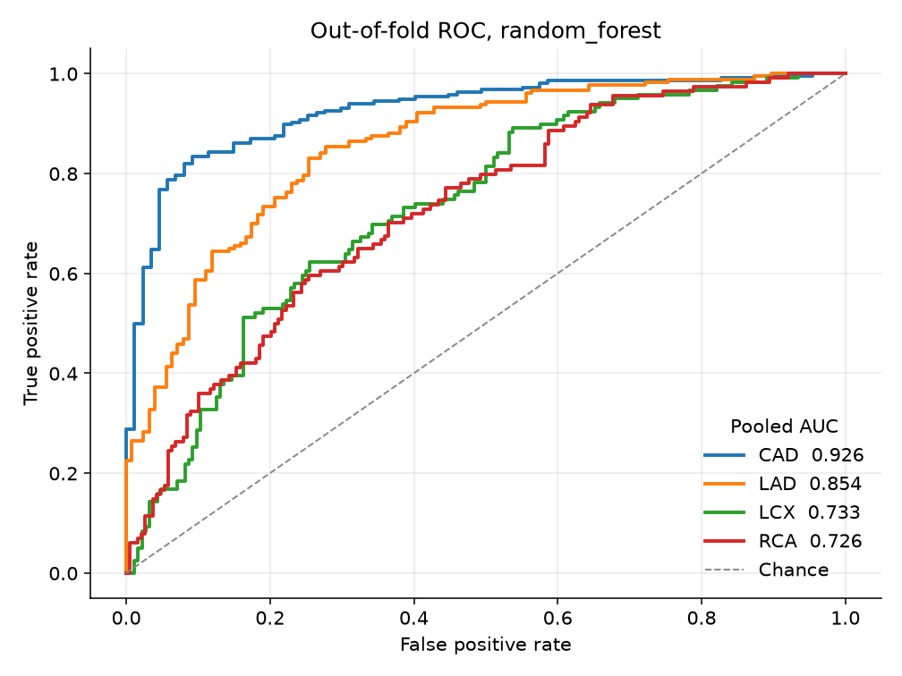
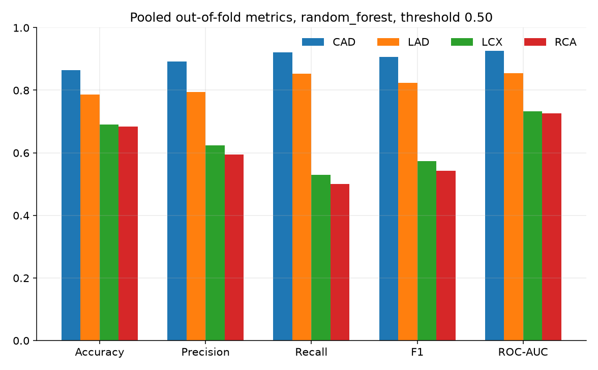
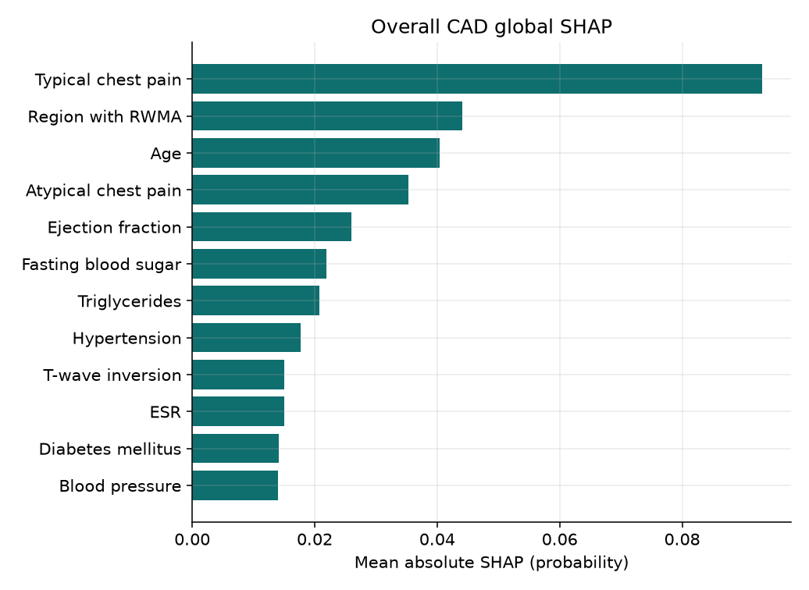

# CardioLens technical report

Track A, Multimodal AI Hackathon 2026. Aman Tebriwal.

CardioLens estimates overall coronary artery disease and significant stenosis of the LAD, LCX, and RCA from routine clinical columns, then shows those probabilities on a labeled schematic heart. The performance numbers below are the out-of-fold scores written by `ml/train.py`. The live model was refit on every row after that evaluation, so a sample-button prediction is an illustration.

## 1. Data and preprocessing

Source: UCI repository entry 411, "extention of Z-Alizadeh sani dataset" (Alizadehsani, Roshanzamir, and Sani, 2013, DOI 10.24432/C5461K). 303 patients, 59 columns, no missing values. The file used here is `ml/data/z_alizadeh_extension.csv`, unpacked from the UCI xlsx. SHA-256 is stored in `ml/metrics/cv_metrics.json`.

Targets, never used as inputs:

| Id | Column | Positive label | Count |
| --- | --- | --- | ---: |
| CAD | Cath | CAD | 216 / 303 |
| LAD | LAD | Stenotic | 177 / 303 |
| LCX | LCX | Stenotic | 119 / 303 |
| RCA | RCA | Stenotic | 114 / 303 |

The UCI note says CAD occurs when at least one vessel is stenotic. That is not exact in this file. Row 93 is Cath Normal, LAD Stenotic, LCX Normal, RCA Normal. Models predict the source labels. The row was not edited.

`Exertional CP` is N on every row and is dropped. Sex value `Fmale` is stored as Female. Yes/no strings become 0/1. Sex becomes `Sex_Male`. Bundle branch block becomes two indicators, with neither block as the baseline. Valve disease becomes an ordinal score: N 0, mild 1, Moderate 2, Severe 3. Function class and region with RWMA stay numeric. The matrix has 55 columns. `assert_no_leakage` runs in training and in the API.

BMI stays in the matrix because it is a source column. The form recomputes it when height or weight changes. SHAP can split credit between BMI, weight, and height. That is collinearity, not leakage.

## 2. Models and validation

Four classifiers, same folds, four targets:

- L2 logistic regression with a standard scaler and `class_weight="balanced"`
- Random forest, 500 trees, depth 6, `min_samples_leaf` 4, `balanced_subsample`
- Histogram gradient boosting, depth 3, 250 iterations, balanced class weight
- XGBoost, 250 trees, depth 3, `scale_pos_weight = n_negative / n_positive` inside each fold

Validation is `StratifiedKFold`, 5 splits, shuffle, `random_state` 42, fit separately per target. Threshold for accuracy, precision, recall, and F1 is fixed at 0.50. It was not tuned on the test fold. ROC-AUC and Brier score use the probabilities.

Selection rule: highest mean ROC-AUC across the four targets. Tie break would be mean F1, then name. The forest won (mean ROC-AUC 0.811), then XGBoost (0.804), histogram gradient boosting (0.787), and logistic regression (0.757).

Pooled out-of-fold metrics for the forest:

| Target | Accuracy | Precision | Recall | F1 | ROC-AUC | Brier |
| --- | ---: | ---: | ---: | ---: | ---: | ---: |
| Overall CAD | 0.865 | 0.892 | 0.921 | 0.907 | 0.926 | 0.118 |
| LAD | 0.785 | 0.795 | 0.853 | 0.823 | 0.854 | 0.167 |
| LCX | 0.690 | 0.624 | 0.529 | 0.573 | 0.733 | 0.209 |
| RCA | 0.683 | 0.594 | 0.500 | 0.543 | 0.726 | 0.207 |

Fold means for ROC-AUC are 0.931 ± 0.041, 0.860 ± 0.067, 0.729 ± 0.081, and 0.725 ± 0.053. CAD accuracy 0.865 beats the majority baseline of 0.713. LCX and RCA do not beat a "always normal" accuracy guess by much (majority accuracy 0.607 and 0.624), but their ROC-AUC values, 0.733 and 0.726, are above 0.50. Recall at 0.50 is the weak spot on those two vessels. Plots: `ml/plots/roc_oof.png`, `confusion_oof.png`, `calibration_oof.png`, `model_comparison_auc.png`, `selected_metrics.png`.

`pytest` reloads `oof_predictions.csv` and checks that the pooled metrics match scikit-learn on that file.

The saved weights are the same forest class, refit on all 303 rows. Files: `ml/models/cad.joblib`, `lad.joblib`, `lcx.joblib`, `rca.joblib`.

## 3. Explanations

`cardiolens_core/explain.py` builds a SHAP `TreeExplainer` with `model_output="probability"`. Training rejects a model if base value plus SHAP values miss the predicted probability by more than 0.03. The shipped forests pass. The largest full-matrix absolute error is about 0.0018 (LCX). The API returns the same check per patient.

Global mean absolute SHAP on the deployed CAD model is led by typical chest pain, region with RWMA, age, atypical chest pain, and ejection fraction. Vessel models share typical chest pain and age, then diverge: LAD leans on wall motion and ejection fraction, RCA on diabetes and ESR. Bars are in `ml/plots/shap_*.png`.

The UI sums SHAP by clinical group (demographics, history, symptoms, exam, ECG, laboratory, echo) for the selected target. Crimson means the feature pushes toward the disease label. Teal means it pushes toward the normal label. The sign is the model's, not a guideline.

## 4. 3D pipeline

`ml/build_heart.py` marches the algebraic heart surface

`(x^2 + 9/4 y^2 + z^2 - 1)^3 - x^2 z^3 - 9/80 y^2 z^3 = 0`,

rotates it so the apex is down, and skews the apex toward anatomical left (+X). Anterior is +Z. About 27k triangles, exported as `web/public/anatomy/heart.glb` (about 0.5 MB).

LAD, LCX, and RCA are not a downloaded coronary mesh. Each centerline is a short list of surface vertices: LAD down the anterior wall to the apex, LCX from the same origin along the left side into the back, RCA from the right ostium around the right side into the posterior crux. Side branches are visual only and inherit the parent color. Paths are in `web/public/anatomy/vessels.json`.

React Three Fiber draws the glTF and `TubeGeometry` along those points. Color interpolates teal, amber, crimson by that vessel's stenosis probability. Orbit controls rotate and zoom. Clicking a tube selects it and switches the SHAP panel to that vessel. Device pixel ratio is capped at 1.5. There is no shadow map and no postprocessing, so the scene stays light without a discrete GPU. The page also lists the three probabilities in HTML, so a missing WebGL context does not hide the estimates.

The geometry is a schematic of typical anatomy. The UI says so. Region with RWMA is an echo code in the feature vector. It is not a coordinate on the mesh.

## 5. Application and how to use it

FastAPI (`backend/app`) loads the four forests and the explainers. `POST /predict` takes the clinical fields and returns four probabilities, labels at 0.50, SHAP rows, and group sums. `GET /bootstrap` returns the form schema, six real sample rows, and the cross-validation card.

The Next.js page is the form, the heart, and the explanation panel. Six samples cover no stenotic vessel, three-vessel disease, LAD only, LCX only, RCA only, and LAD plus LCX. Source angiography labels stay visible until the inputs change.

Local run: API on port 8091, web app on port 3921. One container: `docker build -t cardiolens .` then `docker run --rm -p 3921:3921 cardiolens`. Split hosting steps are in the README.

## 6. Limits

n is 303, from one center, with no external test set. LCX and RCA discrimination is modest. The 0.50 threshold is a display cut, not an operating point chosen for sensitivity. Sample predictions are in-sample. The heart is not this patient's anatomy, and vessel color is not percent diameter stenosis. Nothing here replaces angiography.

## Figures

